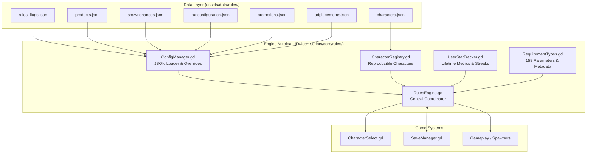

# 158-Parameter Modular Rules & LiveOps Engine

## Overview

The Muakbank Zombie Rules & LiveOps Engine provides a data-driven, zero-overhead conditional evaluation system supporting **158 distinct parameter requirements**. The engine governs player progression, character unlocks, dynamic game configuration, item pricing, spawn tuning, and LiveOps events.

Every parameter, category, and subsystem can be toggled on or off independently at runtime or via JSON configuration without editing or recompiling engine scripts. When a parameter or category is disabled, evaluation short-circuits to a safe default, guaranteeing zero performance impact.

---

## Architecture



### Core Components

1. **`RequirementTypes.gd`** (`scripts/core/rules/RequirementTypes.gd`):
   - Enumerates all 158 requirement parameter IDs (`Type.NONE` through `Type.CUSTOM_PARAM_157`).
   - Categorizes parameters into 10 operational domains (`user_stats`, `monetization`, `platform`, `liveops`, `challenges`, `spawns`, `economy`, `progression`, `gameplay`, `general`).
   - Provides metadata, human-readable labels, and type-safe default values.

2. **`UserStatTracker.gd`** (`scripts/core/rules/UserStatTracker.gd`):
   - Captures player lifetime metrics: `TotalGames`, `TotalRuns`, `NumSessions`, `DaysPlayed`, `DaysSinceLastPlayed`, `CurrentLoginStreak`, `SecondsInRun`, `TotalTimeInRuns`, `CumulativeIAPSpent`, `HoursSinceLastAdWatch`, etc.
   - Automatically computes login streak intervals using UTC day boundaries.
   - Integrates bi-directionally with `SaveManager.gd` for state persistence.

3. **`ConfigManager.gd`** (`scripts/core/rules/ConfigManager.gd`):
   - Loads and parses JSON configs from `assets/data/rules/`.
   - Supports local bundled defaults with a runtime override layer for remote LiveOps delivery.
   - Validates JSON schemas and emits fallback dictionaries on missing or corrupted assets.

4. **`CharacterRegistry.gd`** (`scripts/core/rules/CharacterRegistry.gd`):
   - Maintains the catalog of reproducible survivors and entities.
   - Decouples character visuals, stats, and unlock rules from UI scene code.
   - Evaluates complex conditional unlock rules dynamically against `RulesEngine`.

5. **`RulesEngine.gd`** (`scripts/core/rules/RulesEngine.gd`):
   - Registered as an Autoload singleton: `Rules`.
   - Coordinates requirement evaluation (`evaluate_requirement`, `evaluate_all`).
   - Exposes master, subsystem, category, and individual parameter toggles.

---

## 158-Parameter Taxonomy

The 158 parameters (`RequirementTypes.Type`) are classified into 6 primary operational categories:

### 1. User Stats & Lifetime Progression (IDs 0–24, 50, 59, 84, 86, 119–122)
Tracks user behavior, session frequency, and engagement time.
- `TOTAL_GAMES` (ID 3): Lifetime games initiated.
- `NUM_SESSIONS` (ID 9, 10): App boot sessions.
- `DAYS_PLAYED` (ID 14, 18): Distinct calendar days active.
- `DAYS_SINCE_LAST_PLAYED` (ID 17): Inactivity interval.
- `CURRENT_LOGIN_STREAK` (ID 19): Consecutive calendar days logged in.
- `TOTAL_TIME_IN_RUNS` (ID 21): Cumulative gameplay time in seconds.
- `TOTAL_RUNS` (ID 22): Completed runs.
- `SECONDS_IN_RUN` (ID 23): Duration of the current run.

### 2. Monetization, IAP & Ads (IDs 1, 2, 4, 7, 15, 16, 55–58, 80, 85, 91, 92, 145–147, 149)
Monetization status and purchase tiers.
- `IS_NON_PAYEE` (ID 1): Zero lifetime IAPs completed.
- `IS_PAYEE` (ID 2): At least one valid IAP completed.
- `TOTAL_IAPS` (ID 24): Total count of purchases.
- `TOTAL_IAP_CURRENCY_SPENT` (ID 55): Hard currency spent in store.
- `CUMULATIVE_IAP_SPENT` (ID 56): Lifetime real-world currency spend.
- `LAST_IAP_TIER` (ID 57): Tier index of the most recent purchase.
- `HOURS_SINCE_LAST_IAP` (ID 58): Time elapsed since last transaction.
- `HOURS_SINCE_LAST_AD_WATCH` (ID 80): Elapsed time since last rewarded ad.

### 3. Platform, Device & OS Profiles (IDs 5, 6, 8, 12, 42–45, 65–68, 75–77, 88, 89, 126–141)
Hardware and runtime environment detection.
- `PLATFORM_ANDROID` (ID 5): Running on Android / Termux.
- `PLATFORM_IOS` (ID 6): Running on iOS.
- `PLATFORM_ANDROID_OR_IOS` (ID 8): Mobile target build.
- `IS_DESKTOP_BUILD` (ID 65): Running on Linux / Windows / macOS.
- `IS_HEADLESS_BUILD` (ID 66): Running in CI or headless server mode.
- `DEVICE_MEMORY_TIER` (ID 75): Low / Medium / High RAM profile.
- `TARGET_FRAME_RATE` (ID 76): 60 / 120 / 144 Hz display capability.

### 4. LiveOps, Events & Promotional Campaigns (IDs 46–54, 61–64, 81–83, 87, 90, 142–144)
Calendar events, seasons, and server-driven campaigns.
- `EVENT_ACTIVE` (ID 46): Current LiveOps event flag.
- `CAMPAIGN_ID_ACTIVE` (ID 47): Specific active campaign identifier.
- `CURRENT_SEASON` (ID 48): Seasonal battle pass index.
- `AB_TEST_GROUP` (ID 61): Assigned A/B experiment bucket.
- `PROMOTION_VALID` (ID 62): Promotional window verification.
- `TIME_WINDOW_HOURS` (ID 81): Flash sale or limited event timer.

### 5. Quests, Milestones & Challenges (IDs 69–74)
Achievement triggers and task completion.
- `DAILY_CHALLENGE_MET` (ID 69): Daily objective status.
- `WEEKLY_CHALLENGE_MET` (ID 70): Weekly milestone status.
- `QUEST_INDEX_COMPLETED` (ID 71): Quest tree progression.
- `ACHIEVEMENT_TIER` (ID 72): Milestone tier achieved.

### 6. Gameplay, Custom Variables & System Tuning (IDs 11, 13, 25–41, 93–125, 150–157)
In-game counters, dynamic odds, and custom flags.
- `RANDOM_CHANCE` (ID 11): Normalized dice roll comparison (`0.0` to `1.0`).
- `ZOMBIES_KILLED` (ID 25): Lifetime zombie elimination count.
- `MINIGAMES_WON` (ID 30): Mini-games successfully completed.
- `BOSS_DEFEATED` (ID 35): Specific boss encounter beaten.
- `HIGH_SCORE` (ID 40): Personal best score metric.
- `CUSTOM_FLAG_0` to `CUSTOM_FLAG_157` (IDs 150–157): Open extensible slots.

---

## Independent Enable/Disable Controls

Every layer of the rules hierarchy can be toggled without code modifications:

### 1. Configuration File (`assets/data/rules/rules_flags.json`)

```json
{
  "rules_engine_enabled": true,
  "subsystems": {
    "stat_tracking_enabled": true,
    "ab_testing_enabled": false,
    "telemetry_enabled": false,
    "remote_config_enabled": false,
    "iap_rules_enabled": false,
    "ad_rules_enabled": false,
    "dynamic_spawns_enabled": true,
    "dynamic_run_config_enabled": true,
    "character_rules_enabled": true
  },
  "category_toggles": {
    "monetization": false,
    "user_stats": true,
    "liveops": true,
    "platform": true,
    "challenges": true,
    "spawns": true,
    "economy": false,
    "progression": true,
    "gameplay": true,
    "general": true
  },
  "parameter_toggles": {
    "0": true,
    "1": false,
    "2": false,
    "3": true,
    "157": true
  }
}
```

### 2. Runtime API Methods

```gdscript
# Toggle entire Rules Engine
Rules.rules_engine_enabled = false

# Toggle an entire category
Rules.set_category_enabled(RequirementTypes.CAT_MONETIZATION, false)

# Toggle a specific parameter (0 to 157)
Rules.set_parameter_enabled(RequirementTypes.Type.TOTAL_GAMES, true)

# Query toggle states
var is_active: bool = Rules.is_parameter_enabled(RequirementTypes.Type.TOTAL_GAMES)
```

---

## Reproducible Character Workflow

Characters are defined as structured data rather than hardcoded scene nodes.

### 1. Defining Characters via JSON (`assets/data/rules/characters.json`)

```json
[
  {
    "id": "veteran",
    "name": "VETERAN",
    "scene": "res://scenes/characters/character_veteran.tscn",
    "desc": "Battle-tested with reinforced armor",
    "color": "#4a7c59",
    "base_stats": {
      "max_health": 140.0,
      "move_speed": 4.8,
      "damage_multiplier": 1.2
    },
    "unlock_rules": [
      {
        "type": 3,
        "op": ">=",
        "value": 15
      },
      {
        "type": 19,
        "op": ">=",
        "value": 3
      }
    ]
  }
]
```

### 2. Registering Characters Dynamically via GDScript

```gdscript
var char_data: Dictionary = {
    "id": "cyborg",
    "name": "CYBORG",
    "scene": "res://scenes/characters/character_cyborg.tscn",
    "desc": "High-tech kinetic survivor",
    "color": "#00ffcc",
    "base_stats": {
        "max_health": 150.0,
        "move_speed": 5.2
    },
    "unlock_rules": [
        {
            "type": RequirementTypes.Type.TOTAL_GAMES,
            "op": ">=",
            "value": 25
        }
    ]
}

# Register dynamically into the Autoload
Rules.register_character(char_data)
```

### 3. Character Select Lineup Integration

[`CharacterSelect.gd`](file:///root/muakbank_zombie/scripts/ui/CharacterSelect.gd) automatically connects to `Rules.get_characters()`:
- Renders 3D pedestals across continuous coordinates (`PEDESTAL_X = [-3.4, -1.7, 0.0, 1.7, 3.4, ...]`).
- Dynamically queries `Rules.is_character_unlocked(id)`:
  - If unlocked: Displays `PLAY ▶` (active button).
  - If locked: Displays `LOCKED 🔒` and disables the play action.

---

## Verification & Test Harnesses

### 1. Rules Engine Test Harness

Run headless via Godot on VPS:
```bash
xvfb-run -a /usr/local/bin/godot --headless --path . --script tools/tests/test_rules_engine.gd
```
Asserts:
- All 158 `RequirementTypes` parameters defined and registered.
- `RulesEngine` Autoload initialization and JSON config parsing.
- `UserStatTracker` incrementation, streak calculation, and `get_stat()`.
- Condition comparison operators (`>`, `>=`, `<`, `<=`, `==`, `!=`).
- Individual parameter and category disable/enable bypasses.
- Character registration, roster enumeration, and dynamic unlock rule evaluation.

### 2. 5-Lane Character Select Test Harness

Run headless via Godot on VPS:
```bash
xvfb-run -a /usr/local/bin/godot --headless --path . --script tools/tests/test_character_select_5lane.gd
```
Asserts:
- Simultaneous presence and visibility of all survivor 3D models.
- Upward neon lighting and pedestal emission matching canonical colors.
- 2D unprojected tap zones across full viewport resolution.
- UI button selection state transitions and persistence.


### 3. Character Interchangeability & Reproducibility Test Harness

Run headless via Godot on VPS:
```bash
xvfb-run -a /usr/local/bin/godot --headless --path . --script tools/tests/test_character_interchangeability.gd
```
Asserts:
- Canonical 5-character roster availability.
- Dynamic registration of custom reproducible characters (`Rules.register_character()`).
- In-memory `CharacterStats` construction and scaling without `.tres` asset files.
- `Player.gd` dynamic scene/model extraction and base stat application (`max_health`, `move_speed`, abilities).
- Run lifecycle tracking (`record_run_started`, kills, `record_run_completed`).
- Dynamic unlock rule evaluation with live-updated stats.
